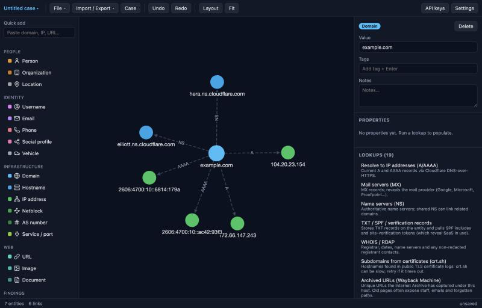
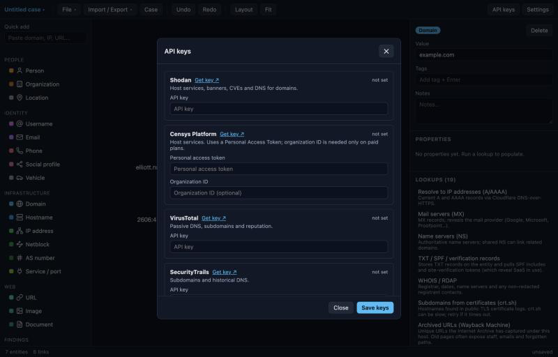

# OSINT Graph

A local, offline-first link-analysis workbench for authorized OSINT and
penetration-testing reconnaissance — a self-hosted tool in the spirit of Maltego,
built around the methodology in Michael Bazzell's *OSINT Techniques*. It maps the
relationships between people, organizations and infrastructure on an interactive
graph.

Everything runs on your machine: a [Tauri](https://tauri.app) (Rust) desktop shell
around a TypeScript graph UI. Projects are plain `.osint` JSON files; API keys live
in the macOS Keychain, never in project files or the cloud.



> **Authorized use only.** This tool aggregates public information about people and
> organizations. Use it only within work you are authorized to do — a penetration
> test with a signed scope, a security assessment, or research on your own
> footprint. Record the authorization in each case's **Case** details; it is
> included in the exported report.

## Features

### Graph & projects
- **Interactive canvas** (Cytoscape.js) — add entities, draw links, auto-layout,
  pan/zoom, highlight a node's neighbourhood.
- **Undo/redo**, duplicate-entity merging (same type + value collapse into one
  node and merge their properties), and autosave once a file path exists.
- **Projects are portable JSON** (`.osint`) — diff them, archive them, read them
  without this app. Case metadata (client, reference, analyst, authorization,
  scope) travels with the graph.

### Entities
- **20 entity types** across people, identity, infrastructure, web and findings,
  each mapped to its Maltego entity id.
- **Paste auto-detection** — drop a domain, IP, email, URL, CVE, phone or handle in
  the quick-add box and the type is inferred.

### Automated lookups (transforms)
Run from the right-hand panel or the right-click menu, on one entity or a whole
selection.

- **No API key required:** DNS (A/AAAA, MX, NS, TXT/SPF/DMARC, PTR), Team Cymru
  ASN/netblock, WHOIS/RDAP for domains and IPs, certificate-transparency
  subdomains (crt.sh), Wayback Machine URLs, web-page scraping (emails, social
  profiles, analytics/ad IDs, server headers), email/phone parsing, Gravatar, VIN
  decode, and a **username check across ~28 sites**.
- **Infrastructure (bring your own key):** Shodan, Censys, VirusTotal (passive DNS
  & reputation), SecurityTrails (subdomains & historical DNS).
- **People & enterprise (bring your own key):** Hunter.io (employee email discovery
  & verification), Have I Been Pwned (breach & paste exposure), DeHashed
  (credential-exposure records), Intelligence X (phonebook).

### Search pivots
Curated, context-aware links that open in your browser for sources that need a
human (login walls, CAPTCHAs, judgement): search engines, people-search, corporate
registries, reverse-image search, maps, caller-ID, reputation and more — tailored to
the selected entity's type.

### Import / export
- **Maltego `.mtgx`** round-trips both ways, so graphs move between this tool and
  Maltego.
- **CSV** (entities and links) and a **Markdown case report** for write-ups.

### Privacy & safety
- API keys are stored in the **macOS Keychain**; `.osint` files hold only the graph.
- Leaked passwords from breach lookups are **masked by default** on the graph
  (toggle in Settings) so raw credentials don't sit in your project file.
- Username hits mean a handle is *taken*, not that it's the same person — the UI
  says so; verify every result.



## Install

### From a release (quickest)
Download the latest `.dmg` from the
[Releases](https://github.com/matt-finish/osint-graph/releases) page, open it, and
drag **OSINT Graph** to Applications.

The app is **not code-signed / notarized**, so Gatekeeper blocks the first launch.
Either right-click the app → **Open** → **Open**, or run:

```bash
xattr -dr com.apple.quarantine "/Applications/OSINT Graph.app"
```

### From source
**Prerequisites**
- [Node.js](https://nodejs.org) 20+ and [pnpm](https://pnpm.io) (`npm i -g pnpm`)
- The [Rust toolchain](https://www.rust-lang.org/tools/install). On macOS via
  Homebrew:
  ```bash
  brew install rustup && rustup-init -y
  # add rustup to your PATH (Homebrew installs it here):
  echo 'export PATH=/opt/homebrew/opt/rustup/bin:$PATH' >> ~/.zshrc
  exec $SHELL -l
  rustup default stable
  ```
- Xcode Command Line Tools (`xcode-select --install`).

**Build & run**
```bash
git clone https://github.com/matt-finish/osint-graph.git
cd osint-graph
pnpm install
pnpm app          # launch the desktop app (first run compiles Rust, ~30s)
```

**Package a standalone app / installer**
```bash
pnpm bundle       # produces a .app and .dmg under src-tauri/target/release/bundle/
```

To develop the UI in a plain browser (fast reload, but native features — Keychain,
CORS-free HTTP, file dialogs — are stubbed):
```bash
pnpm dev          # http://localhost:1420
```

## Quick start

1. Paste a domain, IP or URL in the **quick-add** box (type auto-detected), or pick
   a type from the left palette.
2. Select an entity; run a lookup from the right panel or right-click menu. Free
   lookups work immediately.
3. Add API keys under **API keys** (stored in your Keychain) to unlock Shodan,
   Censys, VirusTotal, SecurityTrails, Hunter, HIBP, DeHashed and IntelX.
4. Fill in **Case** details (including authorization), then export a Markdown
   report or CSV, or a Maltego `.mtgx`.

### Keyboard
| Key | Action |
|---|---|
| `⌘S` | Save |
| `⌘Z` / `⇧⌘Z` | Undo / redo |
| `⌘L` | Auto-layout |
| `L` | Link the two selected entities |
| `Delete` | Delete selection |

## Development

```bash
pnpm test         # vitest unit tests
pnpm build        # type-check (tsc) + production bundle
```

A GitHub Actions workflow (`.github/workflows/release.yml`) builds a **universal**
(Intel + Apple Silicon) `.dmg` and publishes a release whenever a `v*` tag is
pushed.

```
src/            graph UI, data model, transforms, pivots, import/export
  transforms/   free / infrastructure / people lookups + registry
  io/           Maltego .mtgx + CSV/Markdown export
  ui/           graph, palette, inspector, menu, toolbar, dialogs
src-tauri/      Rust backend: HTTP, Keychain, file I/O
```

## Legal

You are responsible for complying with the terms of service of every data source
and API you query, and with the laws and regulations that apply to you. Only
investigate targets you are authorized to investigate.
